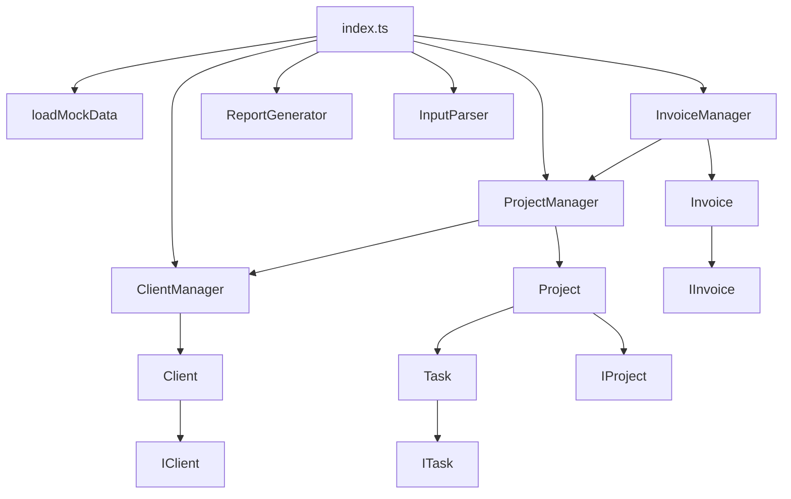

# Freelance Project & Client Management System

TypeScript ile geliştirilen, freelancer çalışma süreçlerindeki **müşteri, proje, görev ve fatura yönetimini** terminal üzerinden modelleyen modüler bir yönetim sistemi.

Proje; TypeScript özelliklerini gerçek bir domain üzerinde uygulamak amacıyla geliştirilmiştir. Framework, veritabanı veya harici API kullanılmadan; **class, interface, custom type, encapsulation, module yapısı, type assertion ve business rule validation** kavramlarına odaklanır.

## İçindekiler

- [Proje Hakkında](#proje-hakkında)
- [Özellikler](#özellikler)
- [Teknolojiler](#teknolojiler)
- [Proje Mimarisi](#proje-mimarisi)
- [Klasör Yapısı](#klasör-yapısı)
- [Domain İlişkileri](#domain-ilişkileri)
- [Business Rules](#business-rules)
- [TypeScript Kavramları](#typescript-kavramları)
- [Kurulum](#kurulum)
- [Komutlar](#komutlar)
- [Örnek Dashboard Çıktısı](#örnek-dashboard-çıktısı)
- [Project Summary](#project-summary)
- [Business Rule Testleri](#business-rule-testleri)
- [Mock Data Senaryosu](#mock-data-senaryosu)
- [Teknik Kararlar](#teknik-kararlar)

## Proje Hakkında

Freelance Project & Client Management System, bir freelancer'ın temel iş akışını nesne yönelimli bir yapı ile simüle eder.

Sistem içerisinde:

- müşteriler oluşturulur,
- müşterilere projeler atanır,
- projelere görevler eklenir,
- görev ve proje durumları yönetilir,
- proje bazlı faturalar oluşturulur,
- tahsilatlar takip edilir,
- proje ve finans verileri raporlanır,
- kritik business rule'lar ayrı test senaryolarıyla doğrulanır.

Uygulama tamamen terminal üzerinden çalışır ve veriler örnek senaryoyu oluşturmak için `mockData.ts` üzerinden belleğe yüklenir.

## Özellikler

- Yeni müşteri ekleme
- Müşteriye proje atama
- Projeye görev ekleme
- Görev durumunu değiştirme
- Proje durumunu değiştirme
- Projenin toplam tahmini çalışma süresini hesaplama
- Proje tamamlanma yüzdesini hesaplama
- Müşterinin toplam proje değerini hesaplama
- Proje için fatura oluşturma
- Faturayı ödendi olarak işaretleme
- Tüm müşterileri listeleme
- Aktif projeleri listeleme
- Tamamlanan projeleri listeleme
- Geciken projeleri bulma
- Belirli bir müşterinin projelerini getirme
- En yüksek bütçeli projeyi bulma
- Ödenmemiş faturaları listeleme
- Toplam faturalanan tutarı hesaplama
- Toplam tahsil edilen tutarı hesaplama
- Detaylı proje özeti üretme
- Genel freelance dashboard raporu üretme
- Dışarıdan gelen `unknown` veriyi güvenli şekilde `ProjectStatus` tipine dönüştürme
- Business rule testlerini ayrı komutla çalıştırma

## Teknolojiler

- **TypeScript 5.9**
- **Node.js**
- **npm**
- ES2020
- Node16 module resolution
- TypeScript `strict` mode

Projede framework, database veya external API kullanılmamaktadır.

## Proje Mimarisi

Kod tabanı sorumluluklarına göre katmanlara ayrılmıştır:

- **Models**: Tekil domain nesnelerini ve kendi davranışlarını yönetir.
- **Interfaces**: Nesnelerin dışarıya sunduğu yapıyı tanımlar.
- **Types**: Status ve priority gibi sınırlı değer kümelerini tanımlar.
- **Services / Managers**: Koleksiyon yönetimi, arama, oluşturma ve domain nesneleri arasındaki koordinasyonu sağlar.
- **Utils**: Raporlama ve dış veri parse işlemlerini gerçekleştirir.
- **Data**: Uygulamanın örnek çalışma senaryosunu yükler.
- **Tests**: Business rule senaryolarını doğrular.



## Klasör Yapısı

```text
FreelanceManagementSystem/
├── src/
│   ├── data/
│   │   └── mockData.ts
│   ├── interfaces/
│   │   ├── IClient.ts
│   │   ├── IInvoice.ts
│   │   ├── IProject.ts
│   │   ├── IReport.ts
│   │   └── ITask.ts
│   ├── models/
│   │   ├── Client.ts
│   │   ├── Invoice.ts
│   │   ├── Project.ts
│   │   └── Task.ts
│   ├── services/
│   │   ├── ClientManager.ts
│   │   ├── InvoiceManager.ts
│   │   └── ProjectManager.ts
│   ├── tests/
│   │   ├── businessRuleTests.ts
│   │   └── runBusinessRuleTests.ts
│   ├── types/
│   │   ├── ClientTypes.ts
│   │   ├── InvoiceTypes.ts
│   │   ├── ProjectTypes.ts
│   │   └── TaskTypes.ts
│   ├── utils/
│   │   ├── InputParser.ts
│   │   └── ReportGenerator.ts
│   └── index.ts
├── .gitignore
├── package.json
├── package-lock.json
├── tsconfig.json
└── README.md
```

## Domain İlişkileri

```text
Client 1 ───── N Project
Project 1 ──── N Task
Project 1 ──── N Invoice
```

### Client → Project

Her proje tek bir müşteriye bağlıdır. `ProjectManager`, proje oluşturulurken ilgili müşterinin gerçekten var olduğunu doğrular. Oluşturulan proje hem merkezi proje listesine hem de müşterinin proje listesine eklenir.

### Project → Task

Görevler doğrudan `Project` tarafından yönetilir. Task koleksiyonu private tutulur ve dışarıya kopyası döndürülür.

### Project → Invoice

Faturalar `projectId` üzerinden projeye bağlanır. `InvoiceManager`, var olmayan bir proje için fatura oluşturulmasını engeller.

## Business Rules

Projede yalnızca veri tutmak yerine domain kuralları da uygulanmaktadır.

### Duplicate ID Kontrolleri

Aynı ID ile ikinci kez:

- Client,
- Project,
- Invoice

oluşturulamaz. Geçersiz işlemde `Error` fırlatılır.

### Project Completion Rule

Bir proje yalnızca bütün task'ları `COMPLETED` olduğunda `COMPLETED` durumuna geçirilebilir.

```ts
if (newStatus === "COMPLETED" && !this.areAllTasksCompleted()) {
  return false;
}
```

Task bulunmayan bir projenin yanlışlıkla tamamlanmış kabul edilmesini önlemek için ayrıca task sayısı kontrol edilir.

### Invoice Validation

Fatura oluşturulmadan önce ilgili `projectId` sistemde aranır. Proje bulunamazsa fatura oluşturulmaz.

### Controlled State Changes

Task ve Invoice status değerleri dışarıdan doğrudan değiştirilmek yerine methodlar üzerinden yönetilir:

```ts
task.changeStatus("COMPLETED");
invoice.markAsPaid();
```

## TypeScript Kavramları

Projede aşağıdaki TypeScript özellikleri aktif olarak kullanılmaktadır.

### Custom Types

Toplam 5 custom type bulunmaktadır:

```ts
type ClientStatus = "ACTIVE" | "INACTIVE";
type ProjectStatus = "PLANNED" | "ACTIVE" | "COMPLETED" | "CANCELLED";
type TaskStatus = "TODO" | "IN_PROGRESS" | "COMPLETED";
type TaskPriority = "LOW" | "MEDIUM" | "HIGH" | "CRITICAL";
type InvoiceStatus = "UNPAID" | "PAID" | "CANCELLED";
```

### Interfaces

Domain yapıları 5 interface ile tanımlanmıştır:

- `IClient`
- `IProject`
- `ITask`
- `IInvoice`
- `IReport`

### Classes

Projede model ve manager sınıfları ayrılmıştır:

- `Client`
- `Project`
- `Task`
- `Invoice`
- `ClientManager`
- `ProjectManager`
- `InvoiceManager`

### Encapsulation

Koleksiyon ve status gibi kontrollü tutulması gereken alanlarda `private` kullanılır.

```ts
private readonly _projects: IProject[] = [];
private readonly _tasks: ITask[] = [];
private _status: ProjectStatus = "PLANNED";
```

Dizi getter'ları gerçek private array yerine shallow copy döndürür:

```ts
get tasks(): ITask[] {
  return [...this._tasks];
}
```

Böylece dış kod private koleksiyonu doğrudan değiştiremez.

### `readonly`

ID'ler ve değiştirilmemesi gereken dependency referansları `readonly` olarak tanımlanmıştır.

```ts
public readonly id: number
constructor(private readonly clientManager: ClientManager) {}
```

### `import type`

Runtime'da kullanılmayan ve yalnızca TypeScript tip sistemi için gerekli importlarda `import type` kullanılmıştır.

```ts
import type { ProjectStatus } from "../types/ProjectTypes";
```

Runtime'da `new` ile kullanılan class'lar ise normal import edilir.

### Type Assertion ve `unknown`

Dışarıdan gelen veri önce `unknown` olarak ele alınır, runtime validation sonrasında `ProjectStatus` olarak assertion uygulanır.

```ts
export function parseProjectStatus(value: unknown): ProjectStatus {
  if (
    typeof value === "string" &&
    (value === "PLANNED" ||
      value === "ACTIVE" ||
      value === "COMPLETED" ||
      value === "CANCELLED")
  ) {
    return value as ProjectStatus;
  }

  throw new Error("Geçersiz proje durumu.");
}
```

Bu yaklaşım doğrudan ve kontrolsüz bir `as ProjectStatus` kullanımının önüne geçer.

### Constructor-Based Dependency Management

Manager bağımlılıkları constructor üzerinden verilir:

```ts
const clientManager = new ClientManager();
const projectManager = new ProjectManager(clientManager);
const invoiceManager = new InvoiceManager(projectManager);
```

Bu yapı bağımlılıkların açık şekilde görülmesini ve sorumlulukların ayrılmasını sağlar.

## Kurulum

Projeyi klonladıktan veya indirdikten sonra proje dizininde:

```bash
npm install
```

TypeScript dosyalarını derlemek için:

```bash
npm run build
```

Uygulamayı çalıştırmak için:

```bash
npm start
```

## Komutlar

| Komut                   | Açıklama                                                              |
| ----------------------- | --------------------------------------------------------------------- |
| `npm install`           | Gerekli development dependency'lerini yükler                          |
| `npm run build`         | TypeScript kaynaklarını `dist/` klasörüne derler                      |
| `npm start`             | Derlenmiş ana uygulamayı çalıştırır                                   |
| `npm run test:business` | Önce projeyi build eder, ardından business rule testlerini çalıştırır |

## Örnek Dashboard Çıktısı

```text
========== FREELANCE DASHBOARD ==========

Clients: 3
Projects: 7

Active Projects: 3
Completed Projects: 2
Planned Projects: 1
Cancelled Projects: 1

Total Project Value: 485.000 TL

Total Invoiced:
320.000 TL

Total Collected:
210.000 TL
==========================================
```

## Project Summary

Her proje için müşteri, bütçe, görevler, durum, tamamlanma oranı, tahmini çalışma süresi ve faturalar ayrı bir özet halinde üretilir.

Örnek:

```text
Project: E-Commerce Website

Client: ABC Teknoloji

Budget: 120.000 TL

Tasks:
✓ UI Tasarımı
✓ Authentication
✗ Product Management
✗ Payment System

Status: ACTIVE

Completion: 50%

Estimated Work: 94 hours

Invoices:
60.000 TL / PAID
40.000 TL / UNPAID
```

Tamamlanma yüzdesi raporlama aşamasında iki ondalık basamağa kadar formatlanır. Örneğin `33.333...` değeri terminalde `33.33%` olarak gösterilir.

## Business Rule Testleri

Business rule testleri ana uygulamadan bağımsız çalıştırılır:

```bash
npm run test:business
```

Mevcut test senaryoları:

1. Duplicate Client ID engellenir.
2. Olmayan Client için Project oluşturulamaz.
3. Duplicate Project ID engellenir.
4. Tamamlanmamış Task bulunan Project `COMPLETED` yapılamaz.
5. Olmayan Project için Invoice oluşturulamaz.
6. Duplicate Invoice ID engellenir.
7. Geçersiz external Project Status reddedilir.
8. Tüm Task'lar tamamlandıktan sonra Project `COMPLETED` yapılabilir.

Güncel test sonucu:

```text
TEST 1 - Duplicate Client ID
PASSED

TEST 2 - Project With Invalid Client
PASSED

TEST 3 - Duplicate Project ID
PASSED

TEST 4 - Complete Project With Incomplete Tasks
PASSED

TEST 5 - Invoice With Invalid Project
PASSED

TEST 6 - Duplicate Invoice ID
PASSED

TEST 7 - Invalid Project Status
PASSED

TEST 8 - Complete Project With Completed Tasks
PASSED
```

**Sonuç: 8/8 business rule testi başarılı.**

## Mock Data Senaryosu

Ana demo senaryosu aşağıdaki verilerle çalışır:

| Veri                | Adet / Değer |
| ------------------- | -----------: |
| Clients             |            3 |
| Projects            |            7 |
| Tasks               |           25 |
| Invoices            |            8 |
| Active Projects     |            3 |
| Completed Projects  |            2 |
| Planned Projects    |            1 |
| Cancelled Projects  |            1 |
| Total Project Value |   485.000 TL |
| Total Invoiced      |   320.000 TL |
| Total Collected     |   210.000 TL |

Mock data, production data kaynağı yerine yalnızca uygulama davranışlarını göstermek amacıyla kullanılmaktadır.

## Teknik Kararlar

- **Models ve Managers ayrıldı.** Model class'ları kendi nesnelerinin davranışlarını yönetirken manager class'ları koleksiyon yönetimi, arama ve nesneler arası koordinasyon görevlerini üstlenir.
- **Client kendi proje bilgisini taşır.** Yeni proje oluşturulduğunda `ProjectManager`, projeyi hem kendi koleksiyonuna hem de ilgili Client'ın proje listesine ekler.
- **Project kendi Task koleksiyonunu yönetir.** Task ekleme ve completion hesapları Project modeli içinde tutulur.
- **Status alanları kontrollü yönetilir.** Project ve Invoice gibi kritik durumlarda doğrudan property mutation yerine method tabanlı geçişler tercih edilir.
- **Constructor üzerinden COMPLETED Project oluşturulamaz.** Project başlangıçta `PLANNED` olur. Böylece tamamlanma kuralı constructor üzerinden bypass edilemez.
- **Private collection'lar dışarıya doğrudan verilmez.** Getter'lar array kopyası döndürerek dışarıdan istemsiz mutation riskini azaltır.
- **Raporlama domain modellerinden ayrıdır.** Terminal çıktıları `ReportGenerator` tarafından hazırlanır; model class'ları presentation sorumluluğu taşımaz.
- **Test runner ana uygulamadan ayrıdır.** `npm start` yalnızca uygulamayı, `npm run test:business` ise business rule testlerini çalıştırır.

---

Bu proje, TypeScript'in tip sistemi ve nesne yönelimli programlama yaklaşımını gerçekçi bir freelance yönetim senaryosu üzerinde uygulamak amacıyla geliştirilmiştir.
